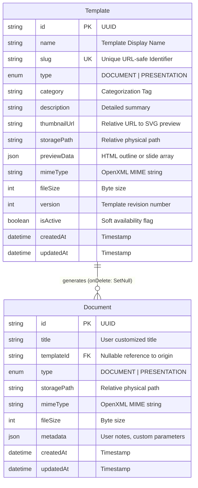

# Software Architecture Document (SAD) — DocuFlow

## 1. Executive Architectural Overview

DocuFlow is designed as a **Modular Monolith** adhering to the principles of **Clean Architecture**, **SOLID design**, and **Domain-Driven Design (DDD)** concepts. The platform decouples presentation, domain business rules, persistence, and physical file storage into isolated layers with well-defined boundaries.

### Architectural Drivers
1. **Immutable Source Strategy**: Template files represent enterprise truth and must never be altered or mutated by end users.
2. **Sub-Millisecond Physical Cloning**: Instant copy operations without blocking user request threads.
3. **Format Integrity**: Strict OpenXML compatibility for both Microsoft Word (`.docx`) and PowerPoint (`.pptx`).
4. **Defense in Depth**: Zero-trust file handling, path traversal prevention, input validation, and transaction rollbacks.
5. **Horizontal Extensibility**: Modular design that easily expands to support Excel (`.xlsx`), PDF, and cloud object stores (e.g. AWS S3, MinIO) without refactoring domain logic.

---

## 2. Layered Structure & Module Responsibilities

### 2.1 Backend Layer Breakdown

```
┌─────────────────────────────────────────────────────────────┐
│                      HTTP Presentation Layer                │
│    Routes  ->  Middlewares (Auth, Val, Sec)  ->  Controllers│
└──────────────────────────────┬──────────────────────────────┘
                               │ (DTOs)
                               ▼
┌─────────────────────────────────────────────────────────────┐
│                      Application Domain Layer               │
│                  Services  (Business Logic)                 │
└──────────────────┬──────────────────────────┬───────────────┘
                   │                          │
                   ▼                          ▼
┌─────────────────────────────┐  ┌────────────────────────────┐
│      Persistence Layer      │  │        Storage Layer       │
│  Repositories (Prisma ORM)  │  │   Physical File Engine     │
└──────────────┬──────────────┘  └────────────┬───────────────┘
               │                              │
               ▼                              ▼
      PostgreSQL Database             Local / S3 Storage
```

1. **Routes Layer (`src/modules/*/*.routes.ts`)**:
   - Maps HTTP verbs and URI paths.
   - Attaches validation middleware with Zod schemas.
2. **Controllers Layer (`src/modules/*/*.controller.ts`)**:
   - Parses HTTP inputs (`params`, `query`, `body`).
   - Delegates business workflows to respective Services.
   - Formats uniform API responses using `sendSuccess` and `sendError`.
   - Never contains database queries or direct filesystem operations.
3. **Services Layer (`src/modules/*/*.service.ts`)**:
   - Enforces business invariants (e.g. template must be active and match type).
   - Coordinates file cloning with database metadata creation.
   - Orchestrates rollbacks (e.g. unlinking files if DB transactions fail).
4. **Repositories Layer (`src/modules/*/*.repository.ts`)**:
   - Encapsulates all Prisma ORM operations.
   - Handles queries, indexes, pagination math, and joins.
5. **Storage Layer (`src/storage/storage.service.ts`)**:
   - Standalone storage abstraction.
   - Implements safe path resolution (`resolveSafePath`), atomic copying (`cloneFile`), streaming (`getReadStream`), and cleanup (`deleteFile`).

---

## 3. Data Flow & Physical Cloning Strategy

### Document Generation Lifecycle

```
User (Browser)               API Gateway / Express               Storage Service          PostgreSQL (Prisma)
     │                                │                                │                         │
     │── 1. POST /from-template/:id ─>│                                │                         │
     │      (title, metadata)         │── 2. Validate template ID ──────────────────────────────>│
     │                                │<── 3. Return template metadata ──────────────────────────│
     │                                │                                │                         │
     │                                │── 4. Verify template active    │                         │
     │                                │── 5. Generate UUID docId       │                         │
     │                                │                                │                         │
     │                                │── 6. cloneFile(src, dest) ────>│                         │
     │                                │<── 7. File copied (size bytes)─│                         │
     │                                │                                │                         │
     │                                │── 8. Create Document Record ────────────────────────────>│
     │                                │<── 9. Record Created ────────────────────────────────────│
     │                                │   [On DB Failure: Unlink dest]                           │
     │<── 10. HTTP 201 Created ───────│                                │                         │
     │                                │                                │                         │
     │── 11. GET /:id/download ──────>│                                │                         │
     │                                │── 12. Retrieve ReadStream ────>│                         │
     │<── 13. Stream Binary File ─────│<── 14. Binary Stream ──────────│                         │
```

### Safety Guarantees
- **No File Overwrite**: Destination paths use version-4 UUIDs, ensuring collisions are mathematically impossible.
- **Atomic Rollback**: If database insertion throws an exception after file copying, the `catch` block unlinks the physical clone immediately.
- **Immutable Originals**: Template files reside in `storage/templates/` and permissions are strictly read-only for template consumer operations.

---

## 4. Database Schema Design

### Entity Relationship Diagram (ERD)



### Key Schema Decisions
1. **`onDelete: SetNull` on Template Relation**:
   - If a business template is retired or deleted, all historical documents generated by users remain intact with full filesystem access.
2. **Composite Indexes**:
   - `@@index([type, category])` accelerates catalog filtering.
   - `@@index([name])` and `@@index([slug])` support search debouncing.
   - `@@index([isActive])` filters active templates in one query pass.

---

## 5. Security & Threat Mitigation (OWASP Top 10)

| Threat Category | Potential Risk | Mitigation Mechanism in DocuFlow |
|---|---|---|
| **A01: Broken Access Control** | Path Traversal (`../../etc/passwd`) | `StorageService.resolveSafePath` validates that resolved paths are contained strictly within `STORAGE_ROOT`. Explicitly blocks `..` and null bytes. |
| **A03: Injection** | SQL Injection | Prisma ORM utilizes parameterized SQL queries for all model access and raw queries. |
| **A03: Content Injection** | Malicious MIME / Extension Spoofing | Strictly controlled OpenXML extensions (`.docx`, `.pptx`). Filenames are sanitized via regex replacing non-alphanumeric chars. |
| **A04: Insecure Design** | Template Corruption / Mutation | Original templates are never opened with write flags; only atomic binary stream copy operations are performed. |
| **A05: Security Misconfiguration** | Information Leakage in Headers | `helmet` middleware disables `X-Powered-By`, enables HSTS, and configures Cross-Origin Resource Policy. |
| **A09: Logging & Monitoring** | Silent Failures | Morgan request logging, standardized error codes, and a comprehensive `/health` endpoint reporting database and storage status. |

---

## 6. Scalability & Cloud Evolution Roadmap

While the MVP utilizes local filesystem storage for self-contained, zero-friction evaluation, the architecture is designed for trivial cloud scaling:

1. **Storage Interface Extraction**:
   - Define `IStorageService` with `saveFile`, `cloneFile`, `getFileStream`, and `deleteFile`.
   - Implement `S3StorageService` (AWS S3, Cloudflare R2, MinIO) with zero changes to `DocumentService` or `PresentationService`.
2. **Database Read Replicas**:
   - Prisma supports read-replica connection pools for scaling high-frequency template catalog reads.
3. **Stateless API Clustering**:
   - Backend Express services are fully stateless and can be scaled horizontally behind an Nginx or AWS ALB load balancer.
