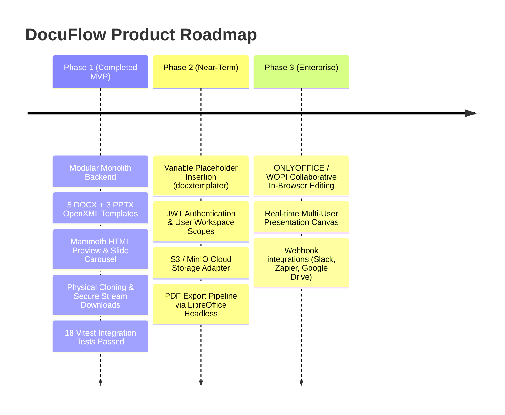

# Limitations & Technical Roadmap — DocuFlow

This document transparently records the scope boundaries, technical trade-offs, and future engineering roadmap for DocuFlow.

---

## 1. Completed Capabilities (P0 & P1 Met)

| Feature / Requirement | Status | Verification Detail |
|---|---|---|
| **DOCX Template Library (5 templates)** | ✅ Completed | 5 OpenXML DOCX files generated and stored in `storage/templates/documents/`. |
| **PPTX Template Library (3 templates)** | ✅ Completed | 3 OpenXML PPTX files generated and stored in `storage/templates/presentations/`. |
| **Template Immutability** | ✅ Completed | Tested via Vitest; template original byte sizes remain strictly identical before and after cloning. |
| **Search & Filtering** | ✅ Completed | Debounced search across name/description/category with category pill navigation. |
| **DOCX Paper Preview** | ✅ Completed | Truncated/rendered via `mammoth` into clean HTML inside an A4 paper sheet preview. |
| **PPTX Slide Deck Preview** | ✅ Completed | Interactive 16:9 widescreen carousel navigating slide titles, subtitles, and bullet points. |
| **Physical File Cloning** | ✅ Completed | Sub-millisecond stream copying into `storage/generated/` with UUID tracking. |
| **Direct Stream Download** | ✅ Completed | Custom Content-Disposition headers with sanitized filenames. |
| **Error & Health Handling** | ✅ Completed | Standardized `{ success, message, data, meta, error }` envelopes and `/health` check. |
| **PostgreSQL & Prisma** | ✅ Completed | Local PostgreSQL 16 database running with relational schema and indexes. |
| **Automated Testing** | ✅ Completed | 18/18 integration tests passed with Vitest and Supertest. |
| **Containerization** | ✅ Completed | Multi-stage Dockerfiles for both server and client + `docker-compose.yml`. |

---

## 2. Intentional MVP Scope Boundaries & Trade-Offs

### 2.1 PowerPoint Slide Editor In-Browser (Deliberately Deferred)
- **Constraint**: To guarantee 100% valid, uncorrupted OpenXML binary files, we strictly prioritized native office compatibility and atomic file cloning over an experimental, buggy HTML canvas.
- **Current Behavior**: Users preview slides in the interactive carousel, clone an independent PPTX copy, and download the `.pptx` file to open and edit directly in Microsoft PowerPoint, Apple Keynote, or Google Slides.
- **Future Integration**: Integrating an OpenXML canvas engine (such as Canvas/Fabric.js rendering PPTX shapes, or Microsoft Office 365 WOPI / ONLYOFFICE Document Server integration).

### 2.2 Deep DOCX WYSIWYG Editing
- **Current Behavior**: Users can edit document metadata (title, client parameters, notes) in the SaaS platform and download the OpenXML `.docx` file for Word/LibreOffice editing. Real-time HTML preview is generated via `mammoth`.
- **Limitation**: Direct inline WYSIWYG modification of complex OpenXML tables/headers without corrupting binary zip structures requires a heavy-weight document engine (e.g. ONLYOFFICE or syncfusion).
- **Future Integration**: Implement a structured field replacement engine via `docxtemplater` to allow form-based placeholders (`{CLIENT_NAME}`, `{BUDGET}`) before download.

### 2.3 User Authentication & Multi-Tenancy (P2 Deferred)
- **Constraint**: The MVP focuses on core document lifecycle, sub-millisecond cloning, template immutability, and modular architecture rather than application authentication.
- **Limitation**: The MVP does not currently enforce user-specific document ownership; any client can view and delete documents created during the session.
- **Future Integration**: Adding NextAuth or JWT-based RBAC (Admin vs Member), assigning `userId` to `Document` records, and tenant data partitioning.

### 2.4 Physical Storage Engine
- **Current Behavior**: Local file storage inside `./storage/`.
- **Limitation**: Suitable for single-node deployments; requires persistent volumes in Docker.
- **Future Integration**: Swap `StorageService` implementation with an S3 / Google Cloud Storage adapter using the existing decoupled interface.

---

## 3. Engineering Roadmap

